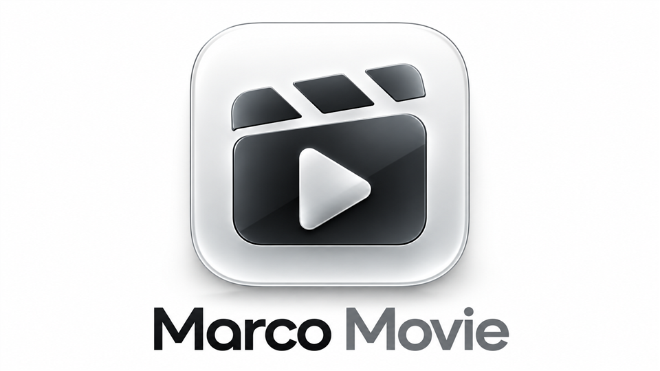

<div align="center">
  
  <h1>Marco Movie</h1>
  <p>为遥控器和大屏幕设计的 Android 电视播放器。</p>
  <p>作者：<a href="https://github.com/Pilipala9919">Pilipala</a> · 版本：0.4.9 Preview · Android 6.0+ · ARM 32 位</p>
  <p><a href="https://github.com/Pilipala9919/MarcoMovie/releases">下载安装</a> · <a href="docs/USER_GUIDE.md">使用指南</a> · <a href="docs/BUILD.md">构建说明</a> · <a href="docs/PRIVACY.md">隐私说明</a></p>
</div>

> **本产品仅为播放与内容管理工具，不内置、不提供、不托管、不售卖任何影视资源，也不提供影视资源配置地址、账号或会员权益。内容及配置需由用户自行合法获取，并确保拥有相应访问和使用权。**

## 产品介绍

Marco Movie 希望让电视上的浏览、搜索和播放更简单：用大幅竖版海报展示内容，以清楚的焦点反馈配合遥控器操作，用柔和的过渡连接首页、搜索和播放页面。应用没有预装片库；第一次打开时，用户需要自行导入有权使用的配置。

这是一个原生 Android 项目。界面、配置管理、播放控制和本地搜索匹配在设备上运行；本项目不运营影视内容服务。项目处于预览阶段，功能和设备兼容性仍在持续完善。

## 能做什么

| 功能 | 当前能力 |
| --- | --- |
| 首页导航 | 首页三击上键回顶、菜单键打开片源选择；右侧紧凑悬浮图标 Dock；聚焦显示小圆角气泡名称，按左返回原内容；二级页面自动隐藏 |
| 大屏首页 | 继续观看横卡、完整分类名称与自动换行、纵向片库；默认每行 5 张 2:3 竖版海报，可调整为 5–8 列 |
| 内容详情 | 大幅竖版海报、边缘渐隐与柔化背景，支持开始/继续播放、简介、收藏和选集，短期缓存加快再次进入；全部二级页面隐藏侧边导航，返回首页时恢复 |
| 我的收藏 | 详情页一键收藏，独立收藏页与移除操作；保存于本机 |
| 继续观看 | 首页继续播放与右侧历史卡片保留集数和进度；先进入介绍选集页，手动确认后续播 |
| 切换内容来源 | 点击首页“发现”标题紧邻的描边来源按钮打开选择弹窗 |
| 全局搜索 | 在已导入、可搜索的配置项之间检索；输入停顿后自动搜索；内置遥控键盘，默认支持中文、全拼和首拼匹配；独立圆角来源筛选按钮、后台匹配、分批增量展示，返回保留结果与位置 |
| 播放控制 | 确认键直接暂停／继续，上下键同步显示顶部片名与集数、独立进度条和紧凑圆角 Dock，中央显示播放状态，顶部显示当前视频实际分辨率；选集、线路、进度、倍速、字幕及更多控制 |
| 小屏继续观看 | 全屏返回缩小到介绍选集页，保留进度与暂停状态；确认小屏恢复全屏 |
| 播放内核 | Media3 与 Android 系统播放器；内置 FFmpeg 音频、AV1 / VP9 视频软解码扩展（[范围与限制](docs/DECODERS.md)） |
| 字幕与弹幕 | 外挂 SRT / VTT / ASS / TTML 字幕；可加载兼容的弹幕数据，不提供在线弹幕资源 |
| 直播列表 | 读取用户提供的兼容列表与分组；不预装频道 |
| 品牌开屏 | 约 3 秒原生品牌动画，高清原 Logo 与屏幕分辨率文字直接合成，结束淡入首页，确认或返回可跳过；支持关闭与减少动态效果 |
| 个性化 | 海报配色柔光随焦点缓慢过渡，支持关闭；自定义壁纸优先，支持本地图片或图片地址、背景压暗、减少动态效果、音效和色彩档位 |
| 账号入口 | 右侧网盘图标向左展开统一账号面板；在扩展支持时提供登录与配置入口，不内置账号 |
| 配置管理 | 地址或本地文件导入、偏好设置、配置备份与还原 |

全局搜索的范围是**用户已导入的配置**，不是互联网全网搜索。拼音匹配结合本地字词典和已浏览/搜索过的标题，首拼存在歧义时可改用完整中文。功能存在不代表任意配置或服务都兼容。

## 安装与开始使用

1. 在 [Releases](https://github.com/Pilipala9919/MarcoMovie/releases) 下载预览 APK，并核对随附的 SHA-256 文件。
2. 在兼容的 Android 电视或盒子上安装。当前发布包包含 `armeabi-v7a` 原生库，需要设备支持 32 位 ARM 应用；不是所有 ARM64 设备都支持。
3. 打开应用，选择“导入我的配置”，导入自行合法获取的配置文件或地址。本项目不提供获取影视资源的方法或地址。
4. 如配置需要执行扩展，在了解并信任其来源后自行开启。进入首页后可用方向键和确认键浏览、搜索、选集与播放。
5. 在“设置”中调整布局、壁纸和播放选项。需要网盘授权时，应由本人在服务提供方界面完成登录。

同一应用签名的安装包一般可以覆盖升级；自行编译会生成自己的开发签名，不能保证覆盖官方项目发布包。卸载会删除应用本地数据，请先妥善保存必要配置。详细操作见[使用指南](docs/USER_GUIDE.md)。

## 设备与预览版边界

- 最低 Android 6.0（API 23）；当前主要验证环境为 Android 9、ARM 32 位电视。最低版本声明不等于每台设备均已实测。
- 兼容标准 JSON 内容接口及部分可选扩展形式，扩展默认关闭。没有承诺所有配置、网盘、直播列表、编码或第三方服务都可使用。
- 磁力组件属于实验能力，要求 Android 8.0+；已完成本地协议测试，尚不作为所有电视上的稳定视频播放能力宣传。
- DRM 仅传递合法授权相关参数，不绕过授权；尚未完成授权样本的端到端验收。
- 持久媒体缓存、渲染视图切换等仍未完成。部分设置依赖系统文件选择器或扩展实现。

更多状态见[功能与验证范围](docs/STATUS.md)。遇到问题可提交 [Issue](https://github.com/Pilipala9919/MarcoMovie/issues)，请勿附带账号、Cookie、私有配置地址、二维码或无权分享的内容。

## 项目结构与开发

```text
android/src/main/       原生应用代码、界面资源、输入词典与第三方许可
android/tests/          本地模拟数据测试，不包含真实影视配置
android/*dependencies.json  固定版本依赖及校验摘要
scripts/               构建、依赖准备、公开内容检查
docs/                  产品、使用、构建、隐私与验证说明
```

当前构建流程基于 Windows、Python 3、JDK 17 与 Android SDK 工具。构建时从依赖发布方下载清单中固定版本的依赖并校验摘要。详见[构建说明](docs/BUILD.md)；不会下载影视配置或内容。

## 作者与第三方致谢

**Marco Movie · Pilipala**  
GitHub：[@Pilipala9919](https://github.com/Pilipala9919)  
Copyright © 2026 Pilipala

感谢 AndroidX Media3、OkHttp、Okio、Gson、QuickJS 及其 Java 包装库、jsoup、CryptoJS、JSONPath、libtorrent / jlibtorrent、Rime 与 Unicode 等项目。它们保留各自作者署名和许可，详见 [THIRD_PARTY_NOTICES.md](THIRD_PARTY_NOTICES.md)。本项目的作者署名不替代第三方版权信息。

原创代码、文档和项目品牌素材按 [GNU GPL v3（GPL-3.0-only）](LICENSE) 发布，另有声明的文件除外。修改与分发时请遵守许可证并保留署名；第三方组件继续适用各自许可。详见 [NOTICE](NOTICE)。

## 工具与内容声明

本产品只是工具，不含任何影视资源。仓库及发布包不包含影视片库、站点配置、订阅地址、直播频道资源、第三方内容插件载荷、账号凭据或会员权益。使用者需要自行合法获取配置与内容，并遵守相关服务条款和适用规则。

项目不承诺第三方内容的合法性、准确性、可用性或持续性，不提供绕过付费、访问控制或数字版权保护的功能。这里的说明用于明确产品边界，不意味着可以忽略版权或其他应承担的责任。请不要在本仓库提交资源分享、侵权内容或账号交易请求。

完整说明见 [DISCLAIMER.md](DISCLAIMER.md)，数据处理见[隐私说明](docs/PRIVACY.md)。
